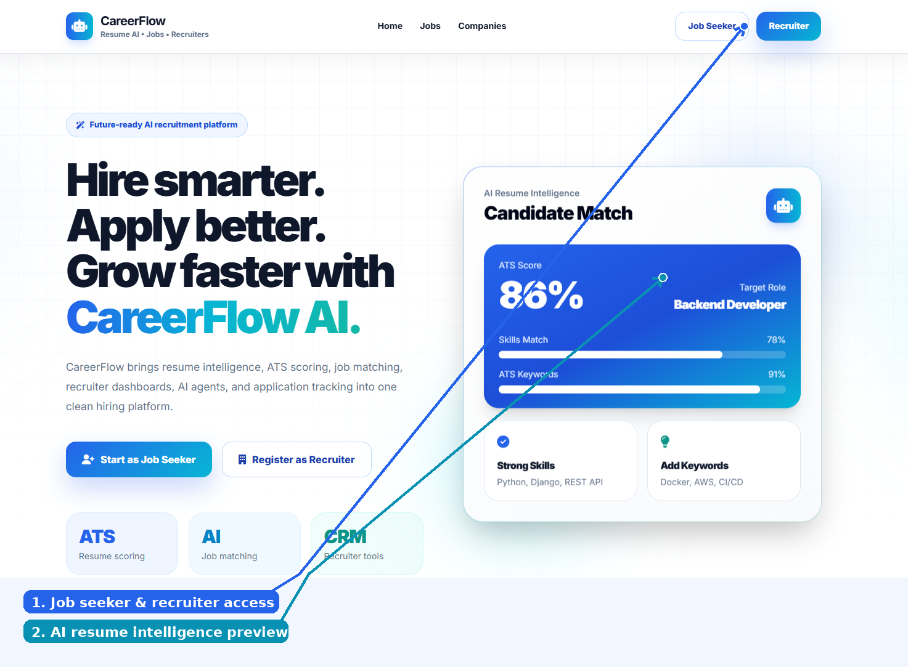
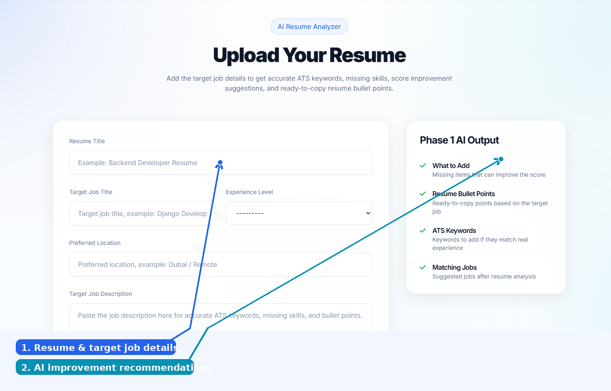
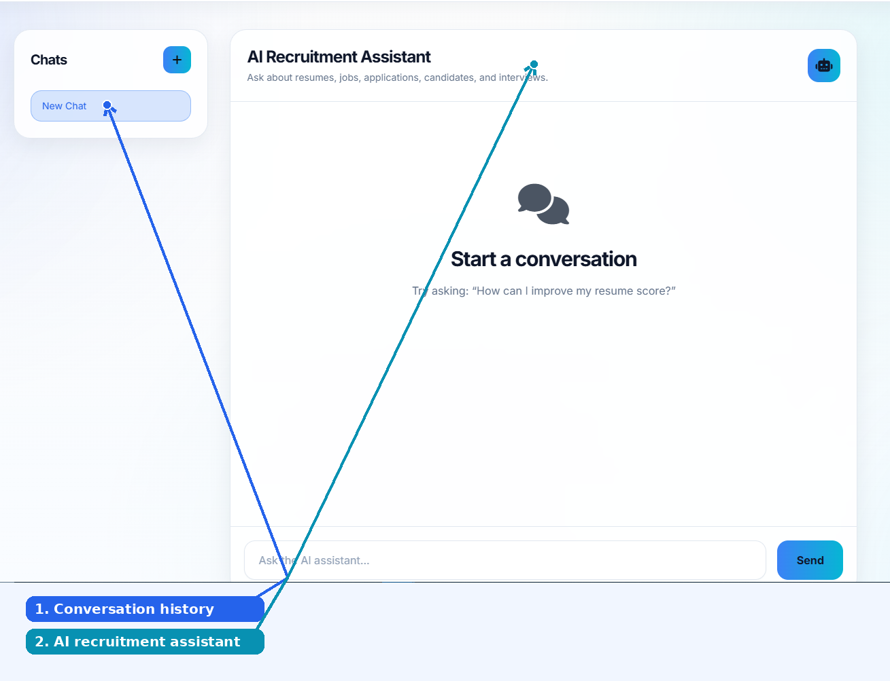
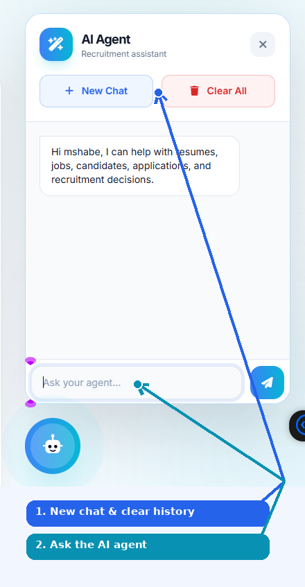
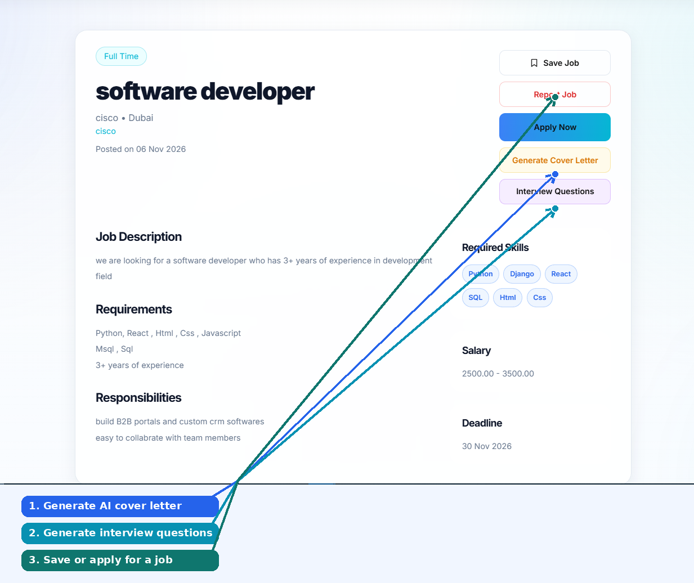
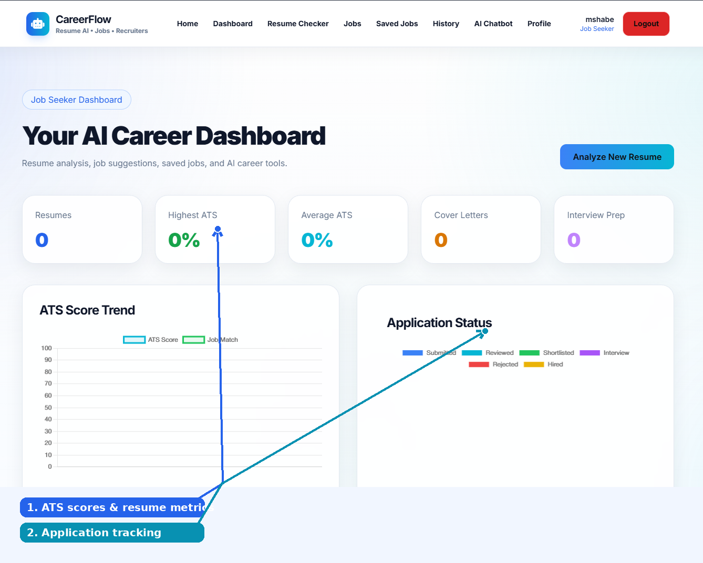
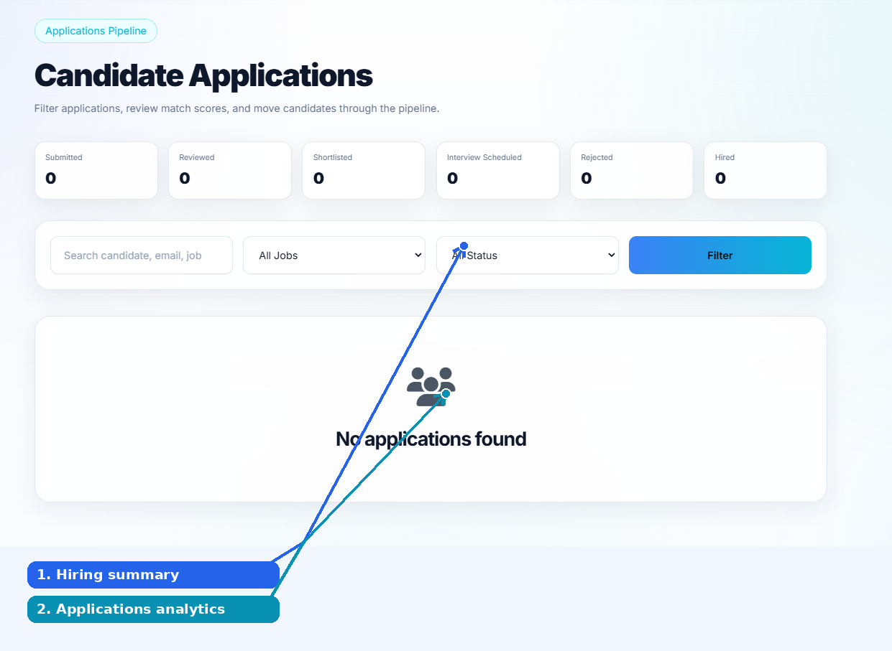
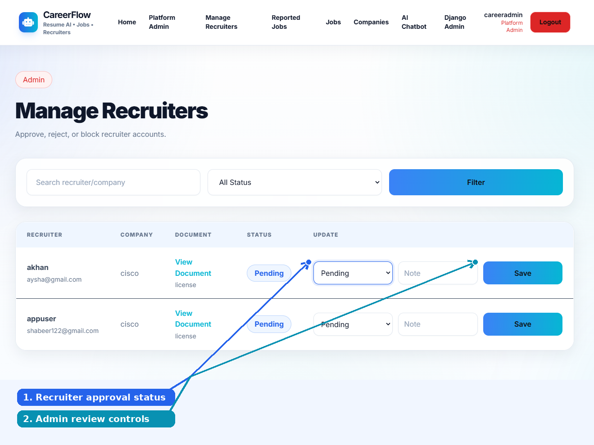

# CareerFlow AI — AI-Powered Recruitment Platform

**Hire smarter. Apply better. Grow faster.**

CareerFlow AI is a Django-based recruitment platform connecting job seekers, recruiters, and platform administrators. It combines **AI resume analysis, ATS scoring, skill-gap recommendations, job matching, cover-letter generation, interview preparation, an AI chatbot, and a tool-enabled AI agent** in a unified workflow.

> **Project status:** Local-development implementation. AI currently uses **Ollama + Qwen3**. Migrating to a hosted AI provider (such as OpenAI API) is a production recommendation, not a completed integration.

## Platform preview



## Key AI features

### 1. Upload a resume → receive an ATS score → find matching jobs

A job seeker uploads a **PDF resume** and provides a target job title, experience level, and optional job description. The system extracts resume text using **PyMuPDF**, analyzes it with **Qwen3 through Ollama**, and stores the resulting assessment.

The analysis provides an **ATS score**, identified skills, missing skills, strengths, weak sections, suggested improvements, and relevant keywords. A job-matching service compares resume skills with job requirements to suggest suitable open roles and calculate match scores. Scores are guidance, not guarantees of employer ATS outcomes.



### 2. AI Chatbot — conversational career guidance

The dedicated **AI Recruitment Assistant** supports conversations about resume improvements, job searching, applications, interview preparation, and recruiter questions. It has a full-page interface with chat sessions and message history.



### 3. Floating AI Agent — context-aware recruitment assistance

The **AI Agent** is separate from the standard chatbot. In addition to conversation, it can select **permission-controlled Django tools** to retrieve relevant platform information, such as a user's latest resume summary, matching jobs, application history, a recruiter's job posts, or candidate rankings where authorized.

Its floating widget includes **New Chat**, **Clear All**, and message input. Sensitive actions should require explicit confirmation; the agent must not make unrestricted database changes.



### 4. AI cover letters and interview questions

On the **job details** page, job seekers can access two highlighted AI tools:

- **Generate Cover Letter:** create a tailored draft using the selected job and resume context.
- **Interview Questions:** generate role-relevant practice questions and suggested answers using job requirements and resume context.

The same page provides **Save Job**, **Report Job**, and **Apply Now** actions.



## Job seeker experience

The job seeker dashboard brings together resume counts, highest/average ATS scores, cover-letter and interview-prep activity, ATS trends, application statuses, and job discovery. Users can browse and filter jobs, save positions, and apply using an analyzed resume.



## Recruiter experience

Approved recruiters can create and manage job posts, define skills and requirements, review applications, search candidates within their permitted scope, and monitor hiring activity through a dashboard and application-status charts.



## Platform administration

Platform administrators review recruiter registrations and supporting documents, **approve, reject, or block** recruiter accounts, and moderate reported jobs. New recruiter accounts start in a pending state until approved.



## Technology stack

| Layer | Technology |
|---|---|
| Backend | Python, Django, Django ORM |
| Frontend | Django templates, HTML, Tailwind CSS, JavaScript |
| Local AI | Ollama + Qwen3 |
| Resume text extraction | PyMuPDF (`fitz`) |
| Charts | Chart.js |
| Development database | SQLite |
| Optional semantic retrieval | ChromaDB / RAG (not assumed deployed) |
| Production recommendations | PostgreSQL, object storage, Gunicorn, hosted AI API |

## How the resume workflow works

```text
Job seeker uploads PDF resume
          |
          v
PyMuPDF extracts text
          |
          v
Prompt service prepares analysis request
          |
          v
Ollama + Qwen3 produces structured assessment
          |
          v
Django stores ATS results and recommendations
          |
          v
Job matching compares skills with open job requirements
          |
          v
Job seeker reviews scores, suggestions and matching jobs
```

## Roles and permissions

| Role | Capabilities |
|---|---|
| Public visitor | Explore platform and public job listings |
| Job seeker | Upload/analyze resumes, search/save/apply for jobs, use AI career tools |
| Recruiter | Manage jobs, applications, candidates and company profile after approval |
| Platform admin | Approve recruiters, review reports, monitor platform activity |

## Run locally

**Prerequisites:** Python, Git, Ollama, and the Qwen3 model.

```bash
python -m venv .venv
```

Activate the virtual environment (Windows PowerShell):

```powershell
.\.venv\Scripts\Activate.ps1
```

Install and initialize:

```bash
pip install -r requirements.txt
ollama pull qwen3:latest
python manage.py migrate
python manage.py runserver
```

Ensure Ollama is running locally and the application's environment configuration points to the correct Ollama server/model. See the project configuration for the required environment variables. Do not commit secrets, `.env` files, or uploaded personal resumes.

## Production considerations

The current AI engine is intended for local development. A public deployment should use **PostgreSQL**, private cloud object storage for resumes and company documents, secure environment variables, proper email delivery, and a hosted AI API if local model hosting is impractical. Enforce per-user and per-recruiter data access and confirmation for sensitive AI-agent actions.

## Roadmap

Planned extensions include interview scheduling, notification center, job alerts, more advanced semantic search, and production analytics. These are **future enhancements**, not current shipped features.

## Project documentation

Detailed functional and technical documentation is available in the separately maintained project documentation PDF.

## Author

Developed by **Muhammed Shabeer**.
